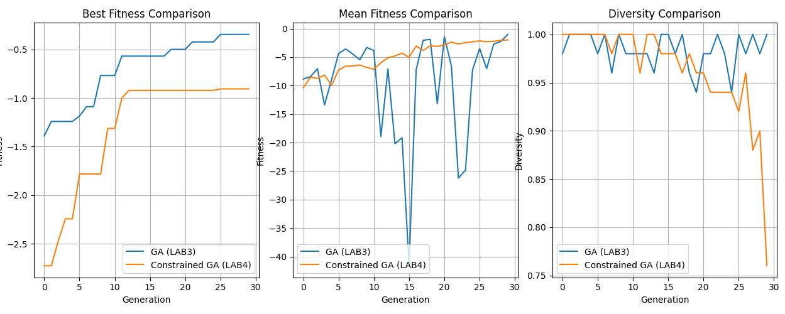

# Heating System Optimization with Genetic Algorithms

This repository contains two implementations exploring heating system design using genetic algorithms and real weather data.

- **LAB3:** Search for heating configurations with good energy, comfort, and cost performance.
- **LAB4:** Introduce constraints and investigate how they affect fitness, convergence, and population diversity.

## Repository Contents

| File | Description |
|---|---|
| `GA.py` | Original LAB3 genetic algorithm |
| `Constrained GA.py` | LAB4 implementation, including unconstrained and constrained comparison modes |
| `Figure_1-2.png` | Example comparison of fitness and diversity |
| `open-meteo-63.16N14.69E312m.csv` | Required weather dataset; place locally before running |

## Heating Configuration

Each individual contains six genes:

| Gene | Type | Initial values |
|---|---|---|
| House size | Numerical | 50–250 m² |
| Insulation | Categorical | Low, medium, high |
| Heater type | Categorical | Electric, gas, heat pump |
| Heater power | Numerical | 2–15 |
| Temperature setpoint | Numerical | 18–24 °C |
| Hysteresis | Numerical | 0.5–3.0 °C |

These are initialization ranges. Bounds during mutation depend on the script and optimization mode.

## Simulation Model

The simulation starts at an indoor temperature of 20 °C and treats each weather observation as one hour.

Indoor temperature changes according to:

- Outdoor temperature.
- Heat loss, depending on house size and insulation.
- Heating input, depending on heater type and power.

The heater switches on below `setpoint − hysteresis` and switches off above `setpoint + hysteresis`.

The simulation records modeled energy, discomfort, and operating cost. Discomfort is the accumulated absolute difference between indoor temperature and the configuration’s setpoint.

## Fitness Function

Both scripts use the following fitness structure:

```text
fitness = −(w1 × energy + w2 × discomfort + w3 × cost) / number_of_timesteps
```

Higher fitness is better.

The available objectives are `eco`, `comfort`, and `budget`, each assigning different weights to the three metrics.

### Differences Between the Scripts

| Setting | `GA.py` | `Constrained GA.py` |
|---|---|---|
| Cost calculation | Energy × 0.2 | Energy × heater-specific factor |
| Default eco weights: energy, discomfort, cost | 3.0, 1.5, 1.0 | 2.0, 1.5, 1.0 |
| Population size | 50 | 50 |
| Generations | 30 | 30 |
| Elite individuals | 3 | 2 |
| Mutation probability per gene | 0.6 | 0.8 |
| Numerical mutation bounds | Applied after numerical mutation | Enforced in constrained mode |
| Output | Generation summaries and best configuration | Statistics, best configurations, and comparison plots |

Because the evaluation settings differ, fitness values from separate executions of these two scripts should not be compared directly.

The LAB4 script performs its own unconstrained-versus-constrained comparison using the same simulation, cost calculation, objective weights, and GA settings for both modes.

## Genetic Algorithm

Both implementations include:

1. Random population initialization.
2. Fitness evaluation using weather data.
3. Tournament selection with three sampled candidates.
4. Uniform crossover, selecting each gene from either parent.
5. Uniform or Gaussian mutation.
6. Elitism to preserve the best individuals.

Gaussian mutation steps decrease over generations, reducing numerical perturbations as the search progresses.

## LAB4 Constraints

The constrained mode enforces these numerical bounds:

| Gene | Permitted range |
|---|---|
| House size | 30–250 m² |
| Heater power | 2–15 |
| Setpoint | 18–24 °C |
| Hysteresis | 0.5–3.0 °C |

It also applies three logical constraints:

| Condition | Requirement |
|---|---|
| Electric heating in a house larger than 180 m² | Heater power ≥ 6 |
| Heat pump selected | House size ≥ 60 m² |
| Low insulation selected | Heater power ≥ 5 |

These rules are modeling assumptions for the experiment, rather than universal engineering requirements.

### Constraint Handling

LAB4 uses hard constraints with replacement.

Invalid individuals are replaced before evaluation, and invalid offspring are replaced during reproduction. Replacement typically copies and mutates a valid individual, clamps numerical values, and checks validity again. A fresh valid individual is generated if needed.

No constraint penalty is added to the fitness function.

## Example Results



The figure compares the two modes inside `Constrained GA.py`.

In this example run:

- Unconstrained optimization reaches a best fitness of approximately −0.35.
- Constrained optimization reaches a best fitness of approximately −0.91.
- Mean fitness fluctuates more strongly in the unconstrained run.
- Constrained diversity decreases to approximately 0.76, while unconstrained diversity stays close to 1.0.

The constrained search produces a worse numerical optimum in this run while enforcing the specified feasibility rules.

These observations come from one stochastic run. Repeated runs with recorded random seeds are needed to establish consistent differences.

### Diversity Measurement

Diversity is the fraction of unique combinations of:

- Rounded house size.
- Insulation.
- Heater type.
- Rounded heater power.

Setpoint and hysteresis are excluded, so this metric measures uniqueness across selected genes rather than complete genetic diversity.

## Installation and Usage

Install the dependencies:

```bash
pip install pandas numpy matplotlib
```

Place the weather CSV in the same directory as the scripts. The loader expects:

- The header on the third line.
- A temperature column named `temperature_2m (°C)`.

Run LAB3:

```bash
python GA.py
```

Run the LAB4 comparison:

```bash
python "Constrained GA.py"
```

LAB3 prints generation summaries and the best configuration. LAB4 prints additional population statistics and displays best fitness, mean fitness, and diversity plots.

Settings can be changed in each script’s `if __name__ == '__main__':` section.

## Limitations

- The thermal model is simplified and does not explicitly model building thermal capacity.
- Energy and cost are model scores rather than validated consumption or currency estimates.
- Installation costs and insulation upgrade costs are excluded.
- Comfort is measured against each individual’s own setpoint.
- The LAB4 unconstrained mode allows numerical genes to move outside their initial ranges.
- Only uniform crossover is implemented.
- Results depend on random initialization and mutation.

The project focuses on designing and analyzing a search process rather than providing engineering recommendations.
